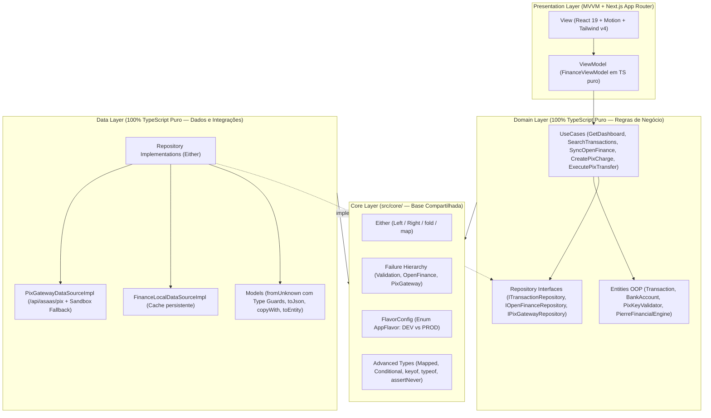

# 02 — Arquitetura: Clean Architecture + SOLID + MVVM em TypeScript

> Todas as camadas (`core/`, `domain/`, `data/`, `legacy/` e `presentation/`) estão implementadas e testadas com Vitest.

## Inspiração Direta: `pos/App_Nasa`

Este projeto transpõe para **TypeScript estrito** a arquitetura em **3 camadas + Core** construída artesanalmente no projeto `App_Nasa`, unindo programação orientada a objetos (classes, encapsulamento, herança, polimorfismo), programação funcional para tratamento de erros (`Either<Failure, Success>`) e separação estrita de responsabilidades (**SOLID**).

## As Camadas e Suas Regras de Dependência

| Camada | Pasta | O que contém | Pode importar de |
|---|---|---|---|
| **Core** ✅ | `src/core/` | `Either<L, R>`, `Failure`, `IUseCase`, `Enums`, `FlavorConfig` (`DEV`/`PROD`), *Mapped/Conditional Types* e *Type Guards* (`unknown`) | Apenas o próprio `src/core/` |
| **Domain** ✅ | `src/domain/` | `entities/` (classes OOP encapsuladas + tuplas), `repositories/` (interfaces de contrato) e `usecases/` (regras de negócio) | `src/core/` |
| **Data** ✅ | `src/data/` | `models/` (`fromUnknown` validando `unknown` sem `any`, `toJson`, `copyWith`), `datasources/` e `repositories/` | `src/core/`, `src/domain/` |
| **Legacy (Refatoração)** ✅ | `src/legacy/` | Código legado original em JS e sua versão refatorada em TS seguro (`RefactoredReconciliationService`) + registro de IA | `src/core/` |
| **Presentation** ✅ | `src/presentation/` | `viewmodel/` (`FinanceViewModel` em TS puro) e `view/` (Landing Page animada, Dashboard Open Finance/PIX e Laboratório da Rubrica) | `src/core/`, `src/domain/`, `src/data/`, `src/legacy/` |

## Os 5 Princípios SOLID no Projeto

1. **S — Single Responsibility Principle (Responsabilidade Única):**
   Cada *UseCase* executa apenas uma operação de domínio (`CreatePixChargeUseCase`, `ExecutePixTransferUseCase`, `SearchTransactionsUseCase`, `SyncOpenFinanceInstitutionUseCase`).
2. **O — Open/Closed Principle (Aberto/Fechado):**
   A classe abstrata `Failure` (`src/core/errors/failures.ts`) é aberta para extensão (`ValidationFailure`, `OpenFinanceFailure`, `PixGatewayFailure`) sem modificar o contrato base consumido pelos *UseCases*.
3. **L — Liskov Substitution Principle (Substituição de Liskov):**
   Qualquer subclasse de `Failure` ou qualquer `Model` que estenda uma `Entity` (`TransactionModel extends Transaction`, `BankAccountModel extends BankAccount`) substitui a classe base preservando o contrato.
4. **I — Interface Segregation Principle (Segregação de Interface):**
   Contratos segregados em `ITransactionRepository`, `IOpenFinanceRepository`, `IPixGatewayRepository` e `IUseCase<SuccessType, Params>`.
5. **D — Dependency Inversion Principle (Inversão de Dependência):**
   Os *UseCases* e o `FinanceViewModel` dependem exclusivamente de abstrações, permitindo alternar entre `AppFlavor.DEV` (Simulador Sandbox) e `AppFlavor.PROD` (API Asaas) em tempo real.
