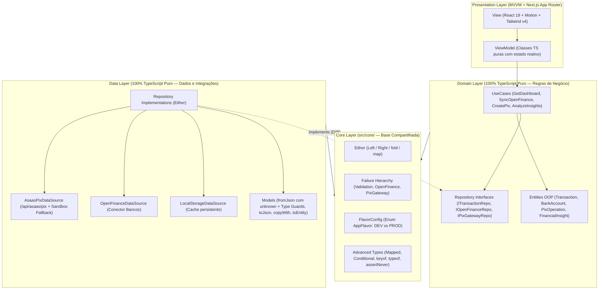

# 02 — Arquitetura: Clean Architecture + SOLID + MVVM em TypeScript

> Documento vivo: atualizado a cada fase. Partes marcadas com ⏳ serão implementadas nas próximas fases.

## Inspiração Direta: `pos/App_Nasa`

Este projeto transpõe para **TypeScript estrito** a mesma arquitetura em **3 camadas + Core** construída artesanalmente em Flutter no projeto `App_Nasa`, unindo programação orientada a objetos (classes, encapsulamento, herança, polimorfismo), programação funcional para tratamento de erros (`Either<Failure, Success>`) e separação estrita de responsabilidades (**SOLID**).

## As Camadas e Suas Regras de Dependência

| Camada | Pasta | O que contém | Pode importar de |
|---|---|---|---|
| **Core** ✅ | `src/core/` | `Either<L, R>`, `Failure`, `IUseCase`, `Enums`, `FlavorConfig` (`DEV`/`PROD`), *Mapped/Conditional Types* e *Type Guards* (`unknown`) | Apenas o próprio `src/core/` |
| **Domain** ⏳ | `src/domain/` | `entities/` (classes OOP encapsuladas + tuplas), `repositories/` (interfaces de contrato) e `usecases/` (regras de negócio) | `src/core/` |
| **Data** ⏳ | `src/data/` | `models/` (`fromJson` validando `unknown` sem `any`, `toJson`, `copyWith`), `datasources/` e `repositories/` | `src/core/`, `src/domain/` |
| **Legacy (Refatoração)** ⏳ | `src/legacy/` | Código legado original em JS fraco e sua versão refatorada em TS seguro para demonstrar evolução técnica (Seção 5) | `src/core/`, `src/domain/` |
| **Presentation** ⏳ | `src/presentation/` | `viewmodel/` (controladores de estado em TS puro) e `view/` (Landing Page animada, Dashboard Open Finance/PIX e Laboratório da Rubrica) | `src/core/`, `src/domain/`, `src/data/` |

## Os 5 Princípios SOLID no Projeto

1. **S — Single Responsibility Principle (Responsabilidade Única):**
   Cada *UseCase* executa apenas uma operação de domínio (ex.: `CreatePixChargeUseCase` apenas valida e emite uma cobrança PIX; `AnalyzeSpendingInsightsUseCase` apenas analisa padrões de gastos estilo Pierre).
2. **O — Open/Closed Principle (Aberto/Fechado):**
   A classe abstrata `Failure` (`src/core/errors/failures.ts`) é aberta para extensão (`ValidationFailure`, `OpenFinanceFailure`, `PixGatewayFailure`) sem precisar modificar o contrato base consumido pelos *UseCases*.
3. **L — Liskov Substitution Principle (Substituição de Liskov):**
   Qualquer subclasse de `Failure` ou qualquer `Model` que estenda uma `Entity` (`TransactionModel extends Transaction`) pode substituir a classe base sem quebrar contratos.
4. **I — Interface Segregation Principle (Segregação de Interface):**
   Em vez de um repositório monolítico `IFinanceRepository`, separamos contratos enxutos: `ITransactionRepository`, `IOpenFinanceRepository` e `IPixGatewayRepository`, além de `IUseCase<SuccessType, Params>`.
5. **D — Dependency Inversion Principle (Inversão de Dependência):**
   Os *UseCases* e *ViewModels* dependem exclusivamente de interfaces (`abstract`/contratos do `domain`), permitindo alternar entre o `Flavor.DEV` (Simulador Sandbox) e `Flavor.PROD` (API Asaas) sem tocar em uma linha da regra de negócio.
